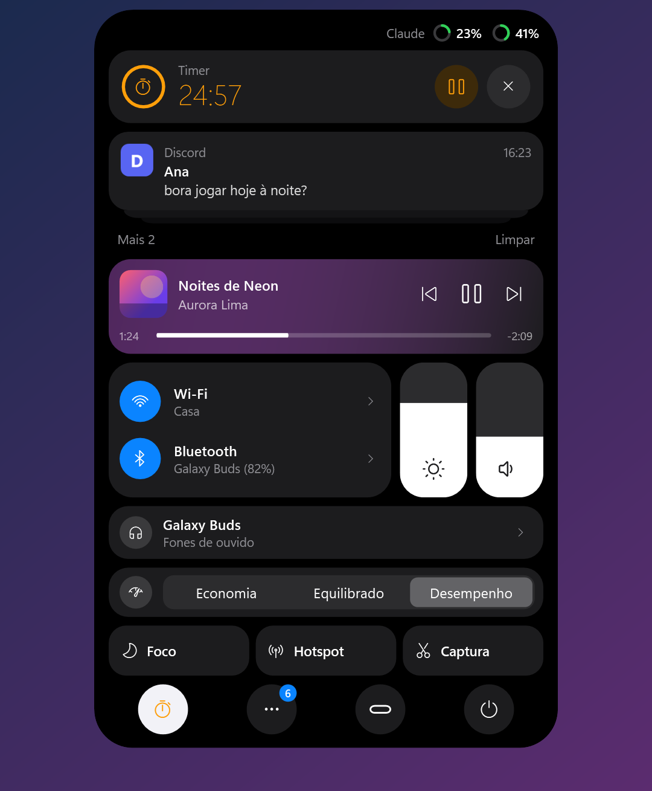
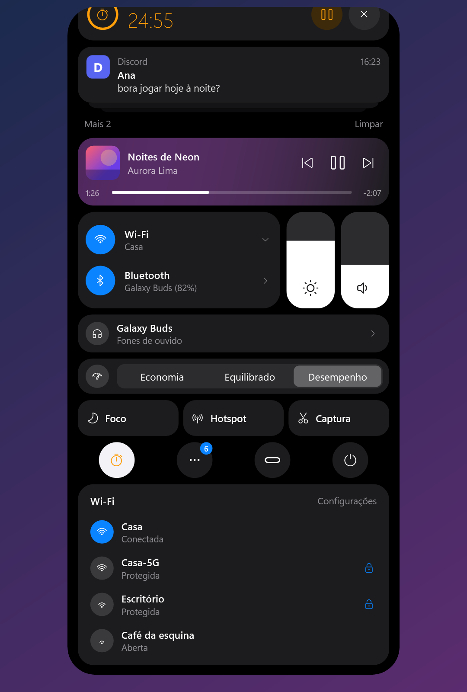
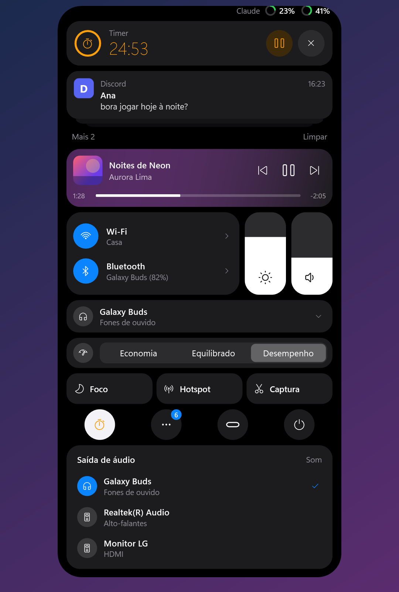

# Notch

Uma ilha dinâmica no estilo do iPhone para o topo do Windows 11. Ela mostra a hora e a bateria, abre sozinha quando algo acontece e vira uma Central de Controle completa quando você passa o mouse. Dá para usar no lugar da barra de tarefas.

<p align="center">
  
</p>

<p align="center">
  
  
</p>

## Instalar

Baixe o `NotchSetup` mais recente em [Releases](../../releases/latest) e abra. A instalação não pede permissão de administrador e já inclui tudo o que o app precisa.

Requer Windows 11 (64 bits).

## O que a ilha faz

**Na pílula**
- Hora e bateria. A bateria fica verde ao carregar e vermelha abaixo de 20%.
- Com música tocando: capa e um equalizador que acompanha o som de verdade.
- Ilha dividida: com música e timer ao mesmo tempo, o timer vira uma bolinha ao lado, com anel de progresso.
- Pontos verde e laranja quando a câmera ou o microfone estão em uso, e uma lua quando o Foco está ligado.
- Esconde-se sozinha quando nada está acontecendo e volta quando você leva o mouse ao topo da tela.

**Avisos**
- Notificações do Windows. Clicar abre o app que enviou.
- Música nova, fone Bluetooth conectado (com a bateria), carregador ligado, bateria fraca e timer concluído.
- Volume e brilho pelas teclas, Caps Lock, microfone silenciado e Foco.

<p align="center">
  
</p>

**Na Central** (cada bloco aparece só quando tem algo a mostrar)
- Notificações empilhadas, timer ou cronômetro, e um player compacto.
- Wi-Fi com a lista de redes e Bluetooth com os aparelhos pareados. Os fones conectam e desconectam ali mesmo.
- Brilho e volume em sliders verticais, e um seletor da saída de áudio.
- Modo de energia: Economia, Equilibrado ou Desempenho.
- Foco, Hotspot e Captura de tela.
- Apps rodando em segundo plano (a bandeja), timer e energia (bloquear, suspender, reiniciar e desligar).
- Arquivos: arraste arquivos até a ilha para guardá-los e depois arraste-os para onde quiser.
- Limites de uso do Claude (opcional).

<p align="center">
  
  
</p>

## Configurações

Pelo botão da mini-ilha na Central, no estilo do Ajustes do iOS. As mudanças valem na hora:
- animações;
- esconder automaticamente e o tempo antes de esconder;
- quais avisos aparecem;
- tamanho da ilha;
- ordem e visibilidade de cada bloco da Central;
- abrir com o Windows;
- **remover a barra de tarefas** do Windows.

Com a barra removida, ela volta quando você desliga a opção, fecha o Notch pelas configurações ou desinstala o app. Se o Notch for encerrado à força, a barra continua escondida até ele abrir de novo. Para trazê-la de volta sem o Notch, reinicie o Explorer (`Stop-Process -Name explorer`).

## Limites do Claude

Desligado por padrão. Quando ligado, mostra quanto da sessão de 5 horas e da semana do seu plano já foi usado, lendo o login do [Claude Code](https://docs.anthropic.com/claude-code) deste computador. O app só conversa com a própria Anthropic e não guarda nem registra o seu token. Esse recurso usa um endereço que a Anthropic não documenta, então pode parar de funcionar sem aviso.

## Limitações conhecidas

- **Bandeja:** o Windows 11 não deixa outros programas lerem os ícones da bandeja. O Notch mostra os apps em segundo plano a partir do registro do Windows. Clicar abre o app, mas o menu do botão direito não está disponível.
- **Wi-Fi:** redes novas que pedem senha abrem a lista do Windows, porque a ilha não recebe teclado.
- **Monitores:** a ilha aparece só no monitor principal.
- **Equalizador:** acompanha o volume do som, não as frequências.

## Compilar

Requer o [.NET 10 SDK](https://dotnet.microsoft.com/download) e, para gerar o instalador, o Inno Setup 6.

```
dotnet run
```

```
winget install JRSoftware.InnoSetup
.\build.ps1
```

O instalador sai em `artifacts\NotchSetup-<versão>.exe`.

**Testes**
- `NotchApp.exe --selftest`: testa a mola das animações, o timer, a cor da capa e a ordem da Central.
- `NotchApp.exe --diag`: lista o que a ilha enxerga do sistema.
- `NotchApp.exe --snapshot <pasta> [--demo]`: gera imagens de cada estado fora da tela. Com `--demo`, usa dados fictícios. As imagens deste README foram feitas assim.
